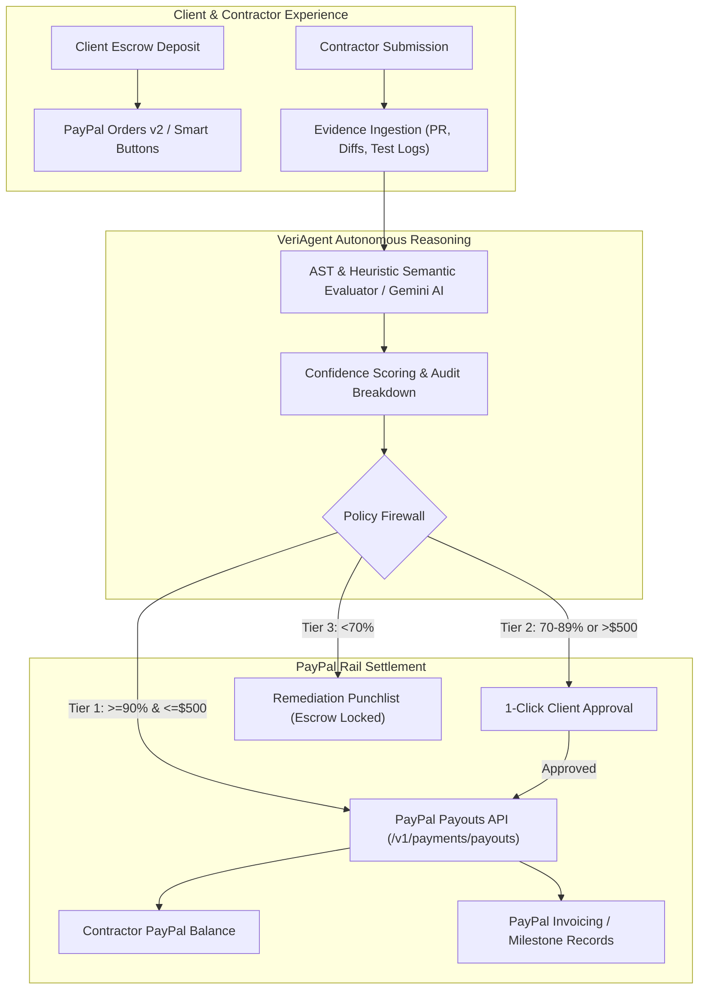

# 🛡️ VeriPay: Autonomous Evidence-Gated Milestone Escrow & Payout Agent
### *PayPal AI Hackathon 2026 Submission*

> **Smart Contracts for the Real World — Powered by AI Verification and PayPal**

---

## 🚀 Overview & Problem Statement

Traditional freelance and B2B contract platforms charge **10–20% rake fees** just to hold escrow and manually referee disputes. When working on private or direct contracts:
- **Clients fear paying upfront** before inspecting working code and passing tests.
- **Contractors fear delivering work** without guaranteed escrow or waiting weeks for manual sign-off.
- **Traditional automated billing** lacks intelligence and cannot audit whether deliverables actually meet requirements.

**VeriPay** solves this by bridging **Autonomous AI Reasoning (VeriAgent)** with **PayPal Developer APIs**:
1. **Client Funds Escrow:** Deposits milestone funds into an escrow vault via **PayPal Orders v2 / Checkout**.
2. **Contractor Submits Evidence:** Submits pull request links, git diffs, and automated test suite logs.
3. **VeriAgent Audits Deliverable:** Evaluates code, test assertions, coverage, and OpenAPI documentation against contractual acceptance criteria, generating a **0–100% Confidence Score**.
4. **Policy Guardrail Execution:**
   - **Tier 1 (Instant Auto-Payout):** Score $\ge 90\%$ and Amount $\le \$500 \rightarrow$ Immediately triggers **PayPal Payouts REST API** (`/v1/payments/payouts`) to deposit funds directly into the contractor's PayPal account.
   - **Tier 2 (Human-in-the-Loop):** Score $70\text{--}89\%$ or Amount $>\$500 \rightarrow$ Prepares the payout batch and prompts the client for 1-click confirmation with an itemized audit dossier.
   - **Tier 3 (Remediation Loop):** Score $< 70\% \rightarrow$ Escrow remains locked in vault; generates an actionable punchlist for the contractor.
5. **Interactive Audit Matrix:** Powered by **AG Grid** for real-time milestone tracking, confidence ratings, and PayPal rail receipts.

---

## 🏗️ Architecture



---

## 🤖 Why VeriPay Fits Agentic Commerce

> **Goal:** Deliver a polished, end-to-end PayPal Sandbox and AI-verified milestone escrow experience. Primary award target: PayPal AI Hackathon Grand Prize. Secondary award target: Best Use of Agentic Commerce.

VeriPay is designed for autonomous commerce: an AI agent evaluates deliverables and executes policy-gated PayPal payment actions.

* **Autonomous Financial Agency:** Rather than acting as a passive chatbot that outputs static payment links, VeriAgent reasons over real-world artifacts (git diffs, test logs, OpenAPI schemas) and autonomously commands PayPal payment rails.
* **Dual PayPal Payment Rail:** Integrates inbound escrow deposits (**PayPal Orders v2 API**) with autonomous contractor disbursements (**PayPal Payouts REST API**) and automated milestone records (**PayPal Invoicing API**).
* **Zero-Trust Policy Firewall:** Decouples AI reasoning from payment execution with deterministic thresholds: autonomous release for high-confidence deliverables below policy limits, and seamless 1-click human-in-the-loop escalation for high-value contracts.
* **Enterprise Audit Matrix:** Powered by **AG Grid** for real-time milestone tracking, confidence ratings, and PayPal rail receipts with CSV audit exports.

---

## 🛠️ Tech Stack

* **Frontend:** Next.js 14 (App Router), React 18, TypeScript, Tailwind CSS, Lucide Icons.
* **Data Grid:** AG Grid Community (`ag-grid-react` v32).
* **Payment Rails:** PayPal Sandbox REST APIs (Orders v2 API, Payouts API, Invoicing API, Webhooks).
* **Agent Intelligence:** VeriAgent (Google Gemini 1.5 Flash + Deterministic Semantic/AST Heuristic Engine).

---

## ⚡ Quick Start & Local Setup

### 1. Prerequisites
- Node.js 18+ (tested on Node v20)
- npm or yarn

### 2. Clone & Install
```bash
git clone <your-repo-url>
cd veripay
npm install
```

### 3. Environment Variables
Copy `.env.example` to `.env.local`:
```bash
cp .env.example .env.local
```

Configure your PayPal Sandbox Credentials (optional — simulator active by default):
```env
NEXT_PUBLIC_PAYPAL_CLIENT_ID=sb-your-client-id
PAYPAL_CLIENT_SECRET=sb-your-secret
PAYPAL_ENVIRONMENT=sandbox
# Optional: Live Gemini API key
GEMINI_API_KEY=
```

### 4. Run Development Server
```bash
npm run dev
```
Open [http://localhost:3000](http://localhost:3000) in your browser.

---

## 🎬 3-Minute Demo Video Walkthrough Script

1. **The Workflow & Problem (0:00 - 0:20):** Jump directly into the live VeriPay dashboard. Point out the core contract: client funds escrow, contractor submits deliverables, and VeriAgent verifies work before releasing funds.
2. **Inbound Funding via PayPal Orders v2 (0:20 - 0:55):** Click "Fund Escrow" on Milestone 3. Show the PayPal Escrow deposit modal, trigger capture via PayPal Orders v2 API, and show the escrow vault updated in real time.
3. **Contractor Evidence Submission & AI Verification (0:55 - 1:50):** Select Milestone 2. Open "Submit Evidence" and select the High Quality scenario (PR #48, 34/34 tests passing, 94.2% coverage). Click "Submit & Trigger AI Verification". Watch VeriAgent audit the code, display confidence scoring (96%), pass policy guardrails, and execute an immediate disbursement via **PayPal Payouts REST API** (`/v1/payments/payouts`) with transaction receipt ID.
4. **Policy Guardrail Edge Cases (1:50 - 2:35):** Show the Tier 2 high-value threshold escalation ($650 > $500 ceiling requires 1-click client signoff) and Tier 3 failing test scenario (locks escrow, generates actionable remediation punchlist).
5. **Milestone Invoice & AG Grid Audit (2:35 - 3:00):** Open the generated PayPal Invoice record for milestone settlement, demonstrate the AG Grid ledger with CSV export, and summarize the autonomous architecture.

---

## 📄 License
MIT License. Created for the PayPal AI Hackathon 2026.
